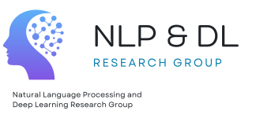

<div align="center">

<!-- Lab / group logo (put your logo in assets/) -->
<a href="https://nlp-dl.etsisi.upm.es/">
  
</a>

# LLM one-shot style transfer for Authorship Attribution and Verification

**Pablo Miralles-González<sup>1</sup> · Javier Huertas-Tato<sup>1</sup> · Alejandro Martín<sup>1</sup> · David Camacho<sup>2</sup>**
 
<sup>1</sup> Department of Computer Systems, Technical University of Madrid, Madrid, Spain
<br>
<sup>2</sup> United Arab Emirates University, Al Ain, United Arab Emirates

**Empirical Methods in Natural Language Processing 2026** &nbsp;·&nbsp; *Findings*

<p>
  <a href="https://arxiv.org/abs/2510.13302"></a>
  <a href="LICENSE"></a>
</p>


</div>

---

## 📰 News

- **[2026-08]** Paper accepted to **EMNLP 2026** 🎉
- **[2025-10]** Preprint available on arXiv.

## 📖 Abstract

> Computational stylometry studies writing style through quantitative textual patterns, enabling applications such as authorship attribution, identity linking, and plagiarism detection. Despite the relevance of language modeling to these tasks, the pre-training of modern large language models (LLMs) has been underutilized in authorship attribution and verification. We introduce an unsupervised framework that uses the log-probabilities of an LLM to measure style transferability between two texts. This framework takes advantage of the extensive Causal Language Modeling (CLM) pre-training, one-shot capabilities and scale of LLMs, avoiding explicit supervision. Our methods substantially outperform prompting-based unsupervised baselines in authorship verification at similar model sizes, and is competitive with or improves contrastive baselines in most settings with sufficient model scale. We further observe strong performance across non-English languages. The effectiveness of the proposed framework improves consistently with increasing model scale. In the case of authorship verification, we propose an additional mechanism that increases test-time computation to improve accuracy; enabling flexible trade-offs between computational cost and task performance.

## ✨ Highlights

- 🔹 **Unsupervised, LLM-native framework:** uses LLM log-probabilities to measure style transferability between two texts, exploiting CLM pre-training, one-shot capabilities and scale, with no explicit supervision.
- 🔹 **Strong results:** substantially outperforms prompting-based unsupervised baselines in authorship verification at similar model sizes, and is competitive with or improves contrastive baselines in most settings with sufficient model scale.
- 🔹 **Scales with model size:** effectiveness improves consistently as the base LLM grows, validated across several datasets for both attribution and verification.
- 🔹 **Multilingual:** strong performance across non-English languages.
- 🔹 **Tunable test-time compute:** for verification, an additional mechanism trades computational cost for accuracy.


## 📁 Repository overview

### Key Scripts

- `osst/simple_example.py`: A simple, hardcoded example showing how to compute attribution scores for a single pair of texts.
- `osst/vllm_logprobs_extractor_opt.py`: Optimized class for extracting token-level logprobs using vLLM.
- `osst/neutralizer.py`: Logic for "neutralizing" text (removing style) to create baseline comparisons.

### How it Works

1. **Neutralize**: Convert both "candidate" and "target" texts into a neutral, simple version.
2. **Prompt**: Build a prompt: `Neutral text: <neutral> \n Styled text: <original>`.
3. **Score**: Use an LLM to calculate the average logprob of the target text.
4. **Compare**: A higher score when conditioned on a specific candidate suggests that candidate is likely the author.

### Setup

1. Install dependencies: `uv sync`.
2. Set your HuggingFace token: `export HF_READ_TOKEN=your_token_here` or write it to the `.env` file.
3. Run the example: `uv run osst/simple_example.py`.


## 📝 Citation

If you find this work useful, please cite:

```bibtex
@misc{mirallesgonzález2026oneshotstyletransferllm,
      title={One-shot Style Transfer LLM log-probabilities for Authorship Attribution and Verification}, 
      author={Pablo Miralles-González and Javier Huertas-Tato and Alejandro Martín and David Camacho},
      year={2026},
      eprint={2510.13302},
      archivePrefix={arXiv},
      primaryClass={cs.CL},
      url={https://arxiv.org/abs/2510.13302}, 
}
```

## 🙏 Acknowledgements

This work has been supported by the following projects: H2020 TMA-MSCA-DN TUAI project "Towards an Understanding of Artificial Intelligence via a transparent, open and explainable perspective" (HORIZON-MSCA-2023-DN-01-01, Grant agreement nº: 101168344); by project PCI2022-134990-2 (MARTINI) of the CHISTERA IV Cofund 2021 program; by EMIF managed by the Calouste Gulbenkian Foundation, in the project MuseAI; and by Comunidad Autonoma de Madrid, CIRMA-CAM Project (TEC-2024/COM-404).

---

<div align="center">

Made with ❤️ by the <a href="https://nlp-dl.etsisi.upm.es/"><b>NLP-DL Lab</b></a> at Technical University of Madrid

</div>